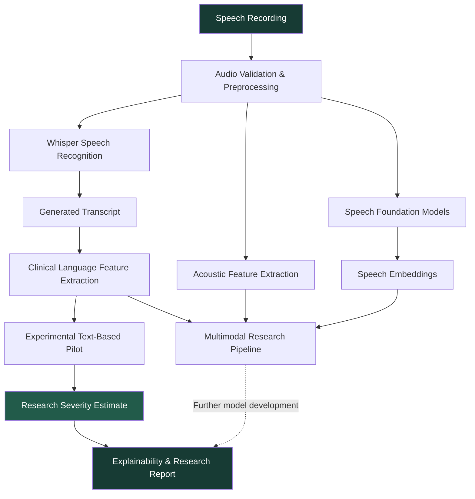

<div align="center">

[](https://git.io/typing-svg)

**An Explainable Multimodal Speech Analysis Research Application**

[IEEE Publication](https://ieeexplore.ieee.org/document/11759575) · [Architecture](#-system-architecture) · [Features](#-key-features) · [Installation](#-getting-started)

<br/>


</div>

---

## Overview

**FoundationSpeech-Aphasia** is an AI-powered research application designed to explore explainable aphasia-focused speech analysis and severity prediction.

The project investigates how speech foundation models, automatic speech recognition, acoustic representations, and clinical language features can be combined to derive meaningful research insights from spoken language.

The application processes speech recordings, generates transcripts using Whisper, extracts linguistic and acoustic features, computes speech representations, and provides an experimental prediction workflow with explainability and automated research reports.

The goal is to explore a more accessible, data-driven approach to speech analysis while maintaining transparency about model behaviour and limitations.

## Research Publication

This project is associated with an IEEE-published research paper.

### FoundationSpeech-Aphasia: A Self-Supervised Multi-Modal Framework for Explainable Aphasia Severity Prediction Using Speech Foundation Models and Clinical Language Analysis

**Authors:**
- Sam Punitha Raj D
- Vishvesh Roshan S
- Chandrasekar A
- Raghavi S

**Publisher:** IEEE

<div align="center">

<a href="https://ieeexplore.ieee.org/document/11759575">

</a>

<br/>

[**View the published paper on IEEE Xplore →**](https://ieeexplore.ieee.org/document/11759575)

</div>

---

## Key Features

<table>
<tr>
<td width="50%">

### Speech Processing
- Audio upload and processing
- Speech validation and preprocessing
- Voice Activity Detection
- Whisper-powered transcription
- Transcript analysis

</td>
<td width="50%">

### Speech Foundation Models
- wav2vec 2.0
- HuBERT
- WavLM
- Whisper Encoder
- Speech embedding extraction

</td>
</tr>
<tr>
<td width="50%">

### Clinical Language Analysis
- Vocabulary diversity
- Lexical richness
- Clause-related linguistic measures
- Transcript-derived features
- Feature provenance

</td>
<td width="50%">

### Explainable AI
- SHAP-based explanations
- LIME-based explanations
- Feature contribution analysis
- Prediction interpretation
- Model limitations

</td>
</tr>
<tr>
<td width="50%">

### Research Workspace
- Analysis history
- Live backend integration
- Analysis summaries
- Model information
- Structured research outputs

</td>
<td width="50%">

### Automated Reporting
- PDF research reports
- Prediction summaries
- Speech feature summaries
- Evaluation information
- Research limitations

</td>
</tr>
</table>

## System Architecture

The application explores a multimodal research architecture while the currently deployed experimental severity predictor uses a transcript-based pilot model.



### Processing Pipeline

| Stage | Description |
|---|---|
| Audio Input | Accepts speech recordings |
| Preprocessing | Audio validation, normalization and voice activity analysis |
| Automatic Speech Recognition | Whisper generates speech transcripts |
| Feature Extraction | Acoustic and linguistic feature computation |
| Speech Representations | Embeddings from supported speech foundation models |
| Prediction | Experimental transcript-based severity prediction |
| Explainability | SHAP and LIME, when supported by an eligible model |
| Reporting | Research summaries and PDF generation |

**Research distinction:** The currently deployed pilot prediction is text-based. The broader multimodal architecture is under development and should not be interpreted as a fully validated fusion model.

## Technology Stack

| Layer | Technologies |
|---|---|
| Frontend | React, Vite, JavaScript |
| Backend | Python |
| Speech Recognition | OpenAI Whisper |
| Speech Foundation Models | wav2vec 2.0, HuBERT, WavLM, Whisper Encoder |
| Audio Processing | Python audio-processing libraries |
| Machine Learning | PyTorch, Scikit-learn |
| Explainable AI | SHAP, LIME |
| Data Management | SQLite |
| Reporting | PDF generation |
| Testing | Pytest |

## Research Model Configurations

The research framework investigates three model configurations.

### Model A — Handcrafted Feature Baseline

```text
Acoustic Features
       +
Clinical Language Features
       ↓
  Ridge Regression
       ↓
  Research Score
```

### Model B — Speech Foundation Model

```text
     Speech Audio
          ↓
      wav2vec 2.0
          ↓
   Speech Embeddings
          ↓
    Regression Head
          ↓
    Research Score
```

### Model C — Proposed Multimodal Framework

```text
Speech Audio ──→ Speech Foundation Model ──→ Speech Embeddings ──┐
                                                                  │
Speech Audio ──→ Acoustic Feature Extraction ─────────────────────┤
                                                                  ├──→ Fusion
Transcript ────→ Clinical Language Analysis ──────────────────────┘
                                                                  ↓
                                                             Transformer
                                                                  ↓
                                                            Regression
                                                                  ↓
                                                          Research Score
```

These configurations are experimental research directions. Their relative performance must be established through appropriate dataset-level evaluation. Model C is not automatically assumed to outperform the baselines.

## Severity Prediction

The framework explores a WAB-R-derived impairment score:

\[
\text{Severity Score} = 100 - \text{WAB-R AQ}
\]

The transformation reverses the direction of the WAB-R AQ scale:

- Lower score: lower WAB-R-derived impairment.
- Higher score: higher WAB-R-derived impairment.

The current deployed text-based pilot has a limited evaluation basis. Its evaluation on human transcripts does not establish equivalent performance on Whisper-generated transcripts.

Predictions are research outputs only and are not suitable for diagnosis, treatment decisions, or independent clinical assessment.

## Application Screenshots

<!-- Add actual screenshots to docs/assets/ and uncomment these sections. -->

<!--
<div align="center">

<br/>
<strong>Research Dashboard</strong>
</div>

<br/>

<div align="center">

<br/>
<strong>Speech Analysis and Experimental Prediction</strong>
</div>

<br/>

<div align="center">

<br/>
<strong>Automated Research Report</strong>
</div>
-->

## Getting Started

### Prerequisites

- Python 3.12
- Node.js and npm
- Git
- Sufficient disk space for speech models and dependencies

### 1. Clone the Repository

```bash
git clone https://github.com/SamPunithaRajD/Foundation-speech-aphasia.git

cd Foundation-speech-aphasia
```

### 2. Configure the Backend

```bash
cd backend

python -m venv .venv
```

Activate the virtual environment.

**Windows**

```bash
.venv\Scripts\activate
```

**Linux / macOS**

```bash
source .venv/bin/activate
```

Install backend dependencies:

```bash
pip install -r requirements.txt
```

Configure the environment variables using the provided `.env.example` file.

Start the backend using the command documented in `backend/README.md`.

### 3. Configure the Frontend

Open a separate terminal:

```bash
cd frontend

npm install

npm run dev
```

Open the local frontend URL displayed by Vite in your terminal.

> Refer to the backend and frontend README files for project-specific configuration and startup commands.

## Project Structure

```text
Foundation-speech-aphasia/
│
├── backend/
│   ├── app/
│   │   ├── features/
│   │   ├── pipelines/
│   │   ├── training/
│   │   ├── explainability/
│   │   ├── services/
│   │   └── resources/
│   │
│   ├── configs/
│   │   ├── datasets/
│   │   └── experiments/
│   │
│   ├── tests/
│   ├── requirements.txt
│   └── README.md
│
├── frontend/
│   ├── src/
│   ├── public/
│   └── package.json
│
├── docs/
│   ├── TARGET_DEFINITION.md
│   ├── DATASET_PIPELINE.md
│   ├── TRAINING.md
│   ├── EVALUATION.md
│   └── MODEL_CARD_TEMPLATE.md
│
├── .gitignore
└── README.md
```

*The structure illustrates the main application areas; individual files may vary as development progresses.*

## Research Integrity & Limitations

FoundationSpeech-Aphasia is an experimental research prototype.

- It is not a certified medical device.
- Its predictions are not a diagnosis.
- The currently deployed pilot uses transcript-derived features.
- Training and evaluation use a small research sample.
- Generalization from human transcripts to Whisper-generated transcripts has not been established.
- Model performance and explainability must be interpreted within their evaluation limitations.
- Predictions should not replace assessment by qualified speech-language professionals.

Patient recordings, identifiable transcripts, credentials, and restricted research datasets must not be committed to this repository.

## Future Research Directions

- Larger and more diverse aphasia datasets.
- Improved validation using paired human and Whisper transcripts.
- Further development of multimodal fusion.
- Robust severity prediction and uncertainty estimation.
- Participant-independent evaluation.
- Improved feature-level explainability.
- Further experimentation with speech foundation models.
- Research collaboration and reproducibility.

## Contributing

Contributions, research discussions, and suggestions are welcome.

To contribute:

1. Fork the repository.
2. Create a feature branch.
3. Implement and test your changes.
4. Submit a pull request describing your modifications.

Please do not contribute patient-identifiable data or unauthorized clinical datasets.

## Acknowledgements

We acknowledge the researchers and organizations contributing to open speech research, speech foundation models, and aphasia research resources.

## License

Add an appropriate open-source license before redistributing this project. Until a license is added, all rights remain with the respective copyright holders.

---

<div align="center">

### Building Explainable AI for Speech Research

*From speech signals to interpretable research insights.*

<br/>

[](https://ieeexplore.ieee.org/document/11759575)

<br/>

[](https://github.com/SamPunithaRajD/Foundation-speech-aphasia)

<br/>


</div>
